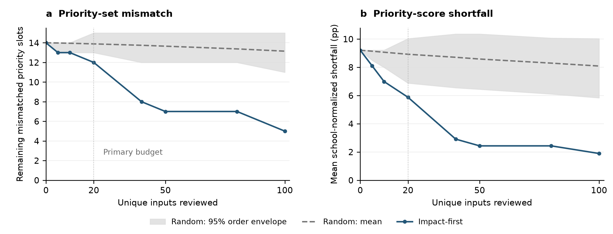

# Auditing the decisions behind LLM summaries

**From classification disagreements to evidence gates and a decision-aware review queue.**

[Portfolio case study](https://hdjang.com/projects/llm-evaluation/) · [Public research report (PDF)](reports/research-report.pdf) · [Follow-up methods](docs/decision-review.md) · [Earlier methods](docs/methods.md)

A school-district partner asked whether its LLM classifications were dependable. I first used Jev disagreements to diagnose prompt, grouping and preprocessing failures. Then I asked a more practical question: **with a limited review budget, which comments could change the support priorities inferred from the survey?**

The study separates relevance, evidence of a current difficulty, and the priority derived from unique respondent counts. It combines source-linked claim gates with an offline review-order experiment. The organization is anonymized as **Company A [Confidential]**.



*The endpoint is a saved model-review proxy, not expert ground truth or actual school decisions. At the frozen primary budget of 20 inputs, impact-first review left 12 priority mismatches versus 13.889 for random review. At 50, it left 7 versus 13.656 (48.7% fewer remaining mismatches). Random means and shaded 2.5th–97.5th percentile envelopes use 1,000 orderings; they are not population confidence intervals.*

## What changed in the follow-up

| Experiment | Observed result | What it does not establish |
|---|---|---|
| Gate unsupported difficulty claims | On 40 targeted cases, false alarms fell from 4/20 to 1/20; whole-comment gating also reduced retained difficulty signals from 10/15 to 5/15. | Population accuracy; operational references were AI-authored. |
| Hold only unsupported categories | Retained signals rose from 5/15 to 6/15; complete automation stayed 30/40. On 433 inputs, 7 assignments across 6 comments were recovered. | A gain in fully automatic completion; partial outputs still require review. |
| Prioritize potential decision impact | At 50 reviews, 7 remaining priority mismatches versus a random mean of 13.656. | Reduced real allocation errors or expert-verified correctness. |
| Inspect review distribution | 18 of the first 20 inputs concentrated in one school. | Fair or adequate school coverage. |

The decision replay used the original semantic classifier, not the per-theme gate. Their combination still needs validation. A model-review reference can also confuse a resolved issue with a present difficulty. The next experiment should use independent adjudication and compare coverage-constrained review under measured analyst time.

The follow-up replay and routing ablation required **zero new API calls**. The recorded large-corpus experiment chain and follow-ups remained within their $10 estimated cap ($9.842894); this is not an invoice or all-time project cost.

## From disagreement to a testable explanation

| Question | Experiment | What was observed |
|---|---|---|
| Where should we investigate? | Blind cross-model audit of 12,531 reconstructed baseline labels | 10,105 supported, 2,224 held, 202 contradicted under the audit policy. These are not correctness labels. |
| Does the prompt conflate relevance with detail? | Fresh original-prompt control versus a relevance-separated prompt on 201 selected cases | 36 off→on and 8 on→off changes; net 28 additional inclusions. |
| Does grouping affect classification? | Batch versus singleton calls, two repetitions per condition | 79 of 150 complete cases consistently switched off→on; 44 stayed off in both conditions. |
| Do richer outputs improve reliability? | Three output designs on 160 responses, two repetitions | The simple singleton design had 157/160 stable binary outcomes; structured binary had 150/160. Generated evidence introduced source-validity failures. |
| Can preprocessing change the decision? | Fresh control versus repaired inputs for 1,171 affected rows | 22 labels changed; 19 changes reproduced in selected follow-up calls. |


*These cohorts overlap. Their changes cannot be added up as corrected classifications. The masking defect was found in this evaluation pipeline; it has not been established as a defect in the historical production system.*

## Earlier engineering findings

The initial proposal used corrected, versioned inputs; singleton classification; strict output validation; bounded retries; and explicit holds when the system cannot make a reliable decision. A second model can prioritize exclusions and uncertain cases for review. It should not silently replace the first model's labels.

The **combined pipeline remains a proposal for shadow validation**, not a deployed or validated replacement. Before automatic exclusion, it needs a new, trusted reference set and measurement of relevant-response loss, retained noise, coverage, availability, latency and cost.

## Run the public companion

Python 3.10+; the offline audit utilities use only the standard library. No API keys, paid calls or private data are required.

```bash
python -m unittest discover -s tests -v
python examples/offline_demo.py

# Optional: regenerate the published figures from aggregate counts
python -m pip install -r requirements-figures.txt
python scripts/plot_figures.py
python scripts/plot_followup.py
```

- `auditkit/`: strict label contracts, paired-transition analysis, repeat-state analysis, dictionary-masking regression fix and the tested per-theme routing gate.
- `examples/`: explicitly invented feedback and labels illustrating the workflow.
- `results/`: selected aggregate findings, guardrail metrics and decision-review curves from the private study.
- `scripts/plot_figures.py` and `scripts/plot_followup.py`: reproducible figures from released aggregates.
- `reports/research-report.pdf`: an English public report; regenerate with `pip install reportlab` and `python scripts/build_report.py`.
- `docs/`: study design, operational comparisons, limitations and validation plan.

The companion demonstrates the analysis logic and reproduces the figures. **It cannot reproduce the private model runs or independently verify their row-level provenance.** The example labels are fixtures, not model predictions and not a benchmark of model accuracy.

## Scope and data availability

The organization is anonymized as **Company A [Confidential]**. This repository contains no source responses, respondent or school identifiers, original questionnaires, model response logs, credentials or executed private notebooks. Aggregate counts are descriptive and do not expose example records.

Models in the study: `claude-haiku-4-5-20251001` and `jev-1.14.0`. Experiments were run in November 2026. Latency is observed client-side elapsed time; costs are usage-based estimates at the experiment's recorded prices, not current quotes or billing statements.

**Daniel (Heedong) Jang** · [Portfolio](https://hdjang.com/) · Applied LLM evaluation
