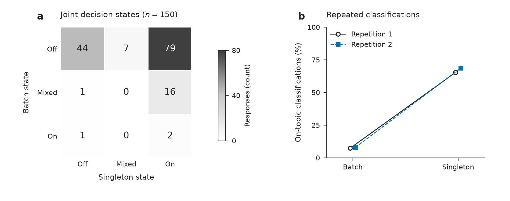
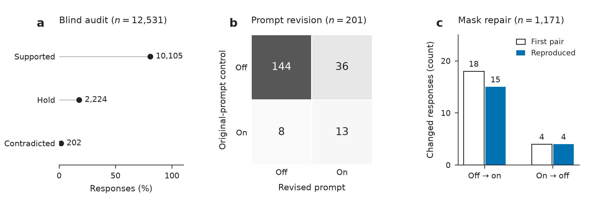

# When the input changes the label

**Auditing an LLM classification pipeline through disagreement analysis and controlled interventions.**

[Read the case study](https://hdjang.com/projects/llm-evaluation/) · [Methods and limitations](docs/methods.md) · [Aggregate results](results/aggregates.json) · [Research figures](figures/research-figures.pdf)

A school-district project used an LLM to identify whether written feedback was relevant to its evaluation rubric. The follow-up request was straightforward: **how can we check whether those classifications are dependable?**

I reconstructed 12,531 baseline labels and used an independent Jev audit to identify disagreements. Rather than treating the second model as ground truth, I used those cases to test specific failure mechanisms: conflating relevance with specificity, changing how responses were grouped, and accidentally masking an ordinary word.

The strongest finding was operational: **a classification can change substantially even when the target text, model and prompt are held fixed.** This study diagnoses sensitivity and contract failures. It does not establish an accuracy improvement.



*Among 150 complete cases selected for follow-up, 79 were off-topic in both batch repetitions and on-topic in both singleton repetitions. The two lines are repeated runs of the same Claude model. They are not a Claude-versus-Jev comparison. Two additional cases were unavailable after bounded retries. [Full caption](figures/captions.txt).*

## From disagreement to a testable explanation

| Question | Experiment | What was observed |
|---|---|---|
| Where should we investigate? | Blind cross-model audit of 12,531 reconstructed baseline labels | 10,105 supported, 2,224 held, 202 contradicted under the audit policy. These are not correctness labels. |
| Does the prompt conflate relevance with detail? | Fresh original-prompt control versus a relevance-separated prompt on 201 selected cases | 36 off→on and 8 on→off changes; net 28 additional inclusions. |
| Does grouping affect classification? | Batch versus singleton calls, two repetitions per condition | 79 of 150 complete cases consistently switched off→on; 44 stayed off in both conditions. |
| Do richer outputs improve reliability? | Three output designs on 160 responses, two repetitions | The simple singleton design had 157/160 stable binary outcomes; structured binary had 150/160. Generated evidence introduced source-validity failures. |
| Can preprocessing change the decision? | Fresh control versus repaired inputs for 1,171 affected rows | 22 labels changed; 19 changes reproduced in selected follow-up calls. |



*These cohorts overlap. Their changes cannot be added up as corrected classifications. The masking defect was found in this evaluation pipeline; it has not been established as a defect in the historical production system.*

## Engineering implications

The proposed next version uses corrected, versioned inputs; singleton classification; strict output validation; bounded retries; and explicit holds when the system cannot make a reliable decision. A second model can prioritize exclusions and uncertain cases for review. It should not silently replace the first model's labels.

The **combined pipeline is a proposal for shadow validation**, not a deployed or validated replacement. Before automatic exclusion, it needs a new, trusted reference set and measurement of relevant-response loss, retained noise, coverage, availability, latency and cost.

## Run the public companion

Python 3.10+; the offline audit utilities use only the standard library. No API keys, paid calls or private data are required.

```bash
python -m unittest discover -s tests -v
python examples/offline_demo.py

# Optional: regenerate the published figures from aggregate counts
python -m pip install -r requirements-figures.txt
python scripts/plot_figures.py
```

- `auditkit/`: strict label contracts, paired-transition analysis, repeat-state analysis and the dictionary-masking regression fix.
- `examples/`: explicitly invented feedback and labels illustrating the workflow.
- `results/aggregates.json`: selected, real aggregate findings from the private study.
- `scripts/plot_figures.py`: reproducible PNG, SVG and PDF figures from those aggregates.
- `docs/`: study design, operational comparisons, limitations and validation plan.

The companion demonstrates the analysis logic and reproduces the figures. **It cannot reproduce the private model runs or independently verify their row-level provenance.** The example labels are fixtures, not model predictions and not a benchmark of model accuracy.

## Scope and data availability

The organization is anonymized as **Company A [Confidential]**. This repository contains no source responses, respondent or school identifiers, original questionnaires, model response logs, credentials or executed private notebooks. Aggregate counts are descriptive and do not expose example records.

Models in the study: `claude-haiku-4-5-20251001` and `jev-1.14.0`. Experiments were run in November 2026. Latency is observed client-side elapsed time; costs are usage-based estimates at the experiment's recorded prices, not current quotes or billing statements.

**Daniel (Heedong) Jang** · [Portfolio](https://hdjang.com/) · Applied LLM evaluation
