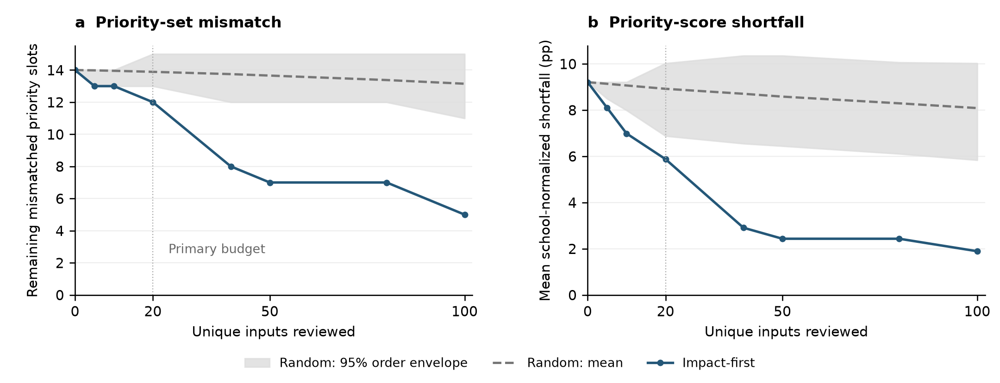

# From label auditing to decision-aware review

Company A [Confidential] · November 2026 · Daniel (Heedong) Jang

## The question changed

The original request was to check an LLM's classifications. Cross-model disagreement exposed sensitivity to prompts, input grouping and preprocessing, but agreement could not establish correctness. A second question mattered for the application: if analysts can inspect only a few comments, which ones could change the support priorities inferred from the survey?

This extension separates three objects: a comment's relevance to a question, an explicitly supported difficulty claim, and a priority derived from respondent counts. A routine activity can be relevant without reporting a difficulty. A classification change can also leave the aggregate priority unchanged.

The decision experiment is an offline replay, not evidence that the district changed its policy or that its real allocation errors decreased. Inspection of saved code did not establish that off-topic labels excluded comments from the historical summary path. That causal claim is not part of the findings.

The foundation was a blind Jev audit of 12,531 newly reconstructed labels: 202 contradictions and 2,224 holds identified investigation targets. In a selected 150-case complete cohort, 79 responses were off-topic in both batch repetitions and on-topic in both singleton repetitions of the same Claude model. Repairing an overbroad masking rule in the evaluation harness changed 22 labels among 1,171 affected rows; 19 changes reproduced. These cohorts overlap, and neither stability nor agreement measures accuracy. The masking defect was not established in the historical production system.

## 1. Gate individual claims

A semantic verifier checks each proposed difficulty category against the whole comment, including negation, attribution, time and resolution. The software retains a category only when both the proposal and an explicit verifier judgment supply a quote present in the source. A quote's presence is not sufficient evidence that it entails the category; this remains a model judgment.

A whole-comment guard holds the entire positive prediction if any proposed category fails. A per-theme guard keeps supported categories and holds only unsupported ones. Partial output still requires review. If no category survives, the result is a hold, not a negative. Initial negative predictions pass through and can retain false negatives.

| Targeted real-case set (n=40) | Improved classifier | Whole-comment gate | Per-theme gate |
|---|---:|---:|---:|
| False alarms among 20 no-difficulty references | 4 | 1 | 1 |
| Difficulty signals retained among 15 positive references | 10 | 5 | 6 |
| False-negative labels among those 15 | 5 | 5 | 5 |
| Usable binary outputs | 40 | 30 | 31 |
| Complete outputs requiring no review | 40 | 30 | 30 |

The remaining five cases had ambiguous operational references. These references were AI-authored, and the cohort was selected after observing errors. It is a diagnostic set, not independent gold or a representative test sample. The per-theme comparison reuses the same predictions and verifier decisions; only routing changes.

In a separate coverage-only replay of 433 unique inputs, usable outputs rose from 329 to 335, while complete automation remained 329/433 (76.0%). Seven additional comment-category assignments survived across six partial comments. This is not seven new teachers or seven unique categories. The 104 comments requiring some review did not decrease. No independent theme-level accuracy reference was available.

## 2. Choose reviews by potential decision impact

The source contains 12,628 rows, 361 distinct respondents and 10 schools. The pre-existing queue contains 433 unique area-plus-masked-comment inputs: all 353 initial positive/unclear inputs plus 80 sampled initial negatives. An input can map to multiple source uses; counts deduplicate each respondent within a school and theme.

The decision proxy selects each school's two most-mentioned positive-count difficulty themes. It is a research proxy, not the district's resource-allocation rule. It does not model severity, urgency or intervention benefit.

At each step, the selector considers 25 counterfactual outcomes for an unreviewed input: no theme, or each of the 24 singleton themes. Using current predictions and source incidence only, it measures how much the current top-two selection could fall short of the best hypothetical selection, normalized by school respondent count. It chooses the largest potential shortfall, breaking ties by mean shortfall and a seeded hash, then recomputes after the review is revealed. Cached review outcomes do not enter selection. This is maximum potential leverage, not a calibrated probability or expected value.

A review reveals a saved later model interpretation. Of 433 inputs, 374 have binary interpretations; 42 remain unclear and 17 are missing. An unresolved review consumes budget and preserves the initial prediction. Unreviewed negatives outside the queue also remain fixed. The endpoint applies every available binary review; zero mismatch at the full endpoint is true by construction.

The primary review budget was frozen at 20 before replay. Random review uses 1,000 seeded orderings. Other recorded budgets are 0, 5, 10, 40, 50, 80 and 100. Reference ties are accepted: mismatch means distance to the closest optimal top-two set, not disagreement with arbitrary tie ordering.

## 3. Results against the model-review proxy

| Inputs reviewed | Random: mean remaining mismatches | Impact-first: remaining mismatches | Random: mean score shortfall (pp) | Impact-first: score shortfall (pp) |
|---:|---:|---:|---:|---:|
| 0 | 14.000 | 14 | 9.208 | 9.208 |
| 20 (primary) | 13.889 | 12 | 8.920 | 5.874 |
| 50 | 13.656 | 7 | 8.582 | 2.431 |
| 100 | 13.148 | 5 | 8.086 | 1.890 |

At 20 inputs, remaining mismatch was 13.6% lower than the random mean. At 50, it was 48.7% lower. These compare remaining mismatches at the same review count; they are not accuracy gains or reductions in actual school decision errors. The shortfall metric averages school-normalized selected-theme count deficits, expressed in percentage points.

The shaded random envelope is the 2.5th–97.5th percentile across random orderings, not a population confidence interval. Results use one fixed impact ordering; five hash tie seeds yielded 11–12 mismatches at the primary budget.

The impact policy read longer comments: 2,770 words at 50 inputs versus 2,147 words on average for random review. A post-hoc equal-word-cap check (unchanged order) still gave 7 versus 13.555 mean mismatches at 2,770 words, with random review reaching 64.3 inputs on average. Word count is not measured human review time.

An earlier cached model pass as an alternative endpoint gave 15 versus 16.275 mean mismatches at 20, 10 versus 15.602 at 50, and 7 versus 14.877 at 100. This checks sensitivity to one alternative model interpretation; neither endpoint is ground truth.

## 4. The governance finding

Impact maximization concentrated 18 of the first 20 inputs in one school, reaching only three schools at the primary budget. School-normalized rates can make a small school's inputs influential. The rule has no minimum coverage constraint. A future comparison must test coverage-constrained impact review, stratified random review and the unconstrained policy under the same budget.

The review reference itself can fail: one inspected interpretation treated a previously resolved issue as a present difficulty. Its label was not silently edited to improve the result. Independent adjudication must distinguish current obstacles from past or resolved ones.

These observations argue for an auditable review workflow: source-linked claims, explicit partial/hold states, respondent deduplication, recorded selection reasons, a coverage check and human authority over final support priorities. They do not establish regulatory compliance or a validated autonomous decision system.

## 5. What would justify deployment?

1. Freeze a new test cohort before tuning. Have domain reviewers adjudicate relevance, current difficulty and theme-level evidence separately; resolve reviewer disagreement and report it.
2. Define the actual support-priority decision with the organization. Test severity and intervention relevance rather than assuming frequency is the correct objective.
3. Compare random, stratified, impact-first and coverage-constrained review using the same reviewers and measured review time, with hidden labels and preregistered budgets.
4. Measure false alarms, missed difficulties, accepted-claim precision, complete automation, partial coverage, unresolved workload and school coverage separately.
5. Run the combined pipeline in shadow mode with versioned inputs, model IDs, prompts, contracts and rollback. The decision replay used the original semantic classifier, not the per-theme guardrail; this release does not claim to have validated their combination.

## Reproducibility, cost and privacy

The guardrail routing and decision replay reused saved predictions and made zero new model requests. The recorded cumulative estimate for the registered large-corpus experiment chain and follow-ups was $9.842894, within its $10 cap. This is not a billing statement or the cost of every earlier project activity.

The repository releases aggregate curves, routing code, synthetic contract tests and figure generation. It does not release respondent records, school identifiers, source comments, questionnaire text, input hashes or private notebooks. The organization remains Company A [Confidential]. Aggregate figures can be reproduced locally; the private model runs and respondent-level provenance cannot be independently rerun from this release.

Earlier models: `claude-haiku-4-5-20251001` and `jev-1.14.0`. Jev was the independent audit signal in the classification phase; the later semantic review replay is not a Claude-versus-Jev accuracy comparison.
